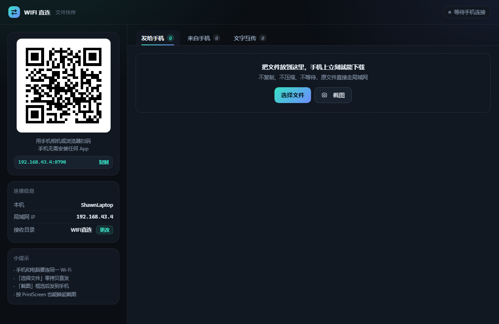
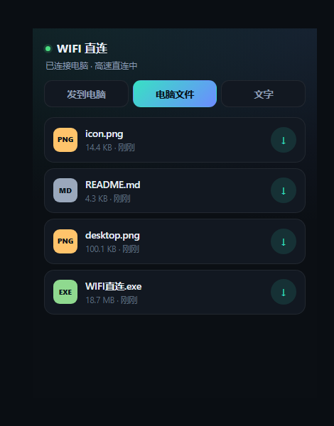
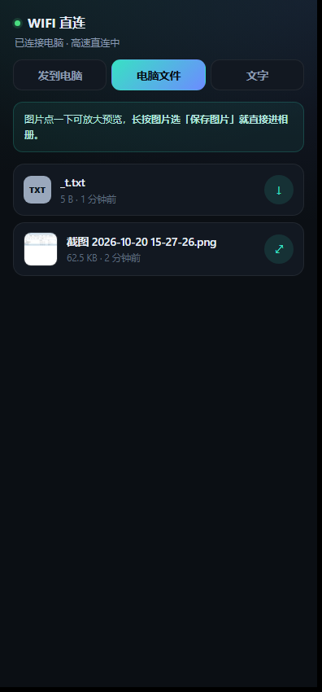
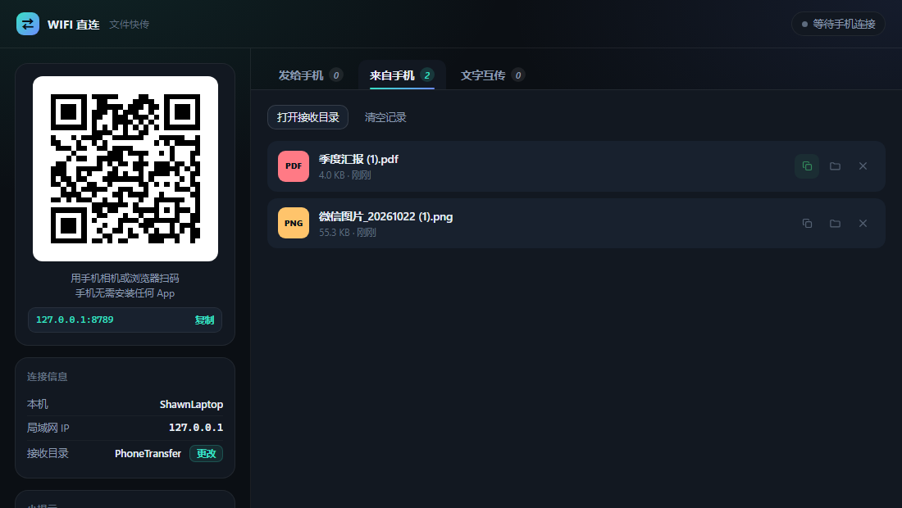
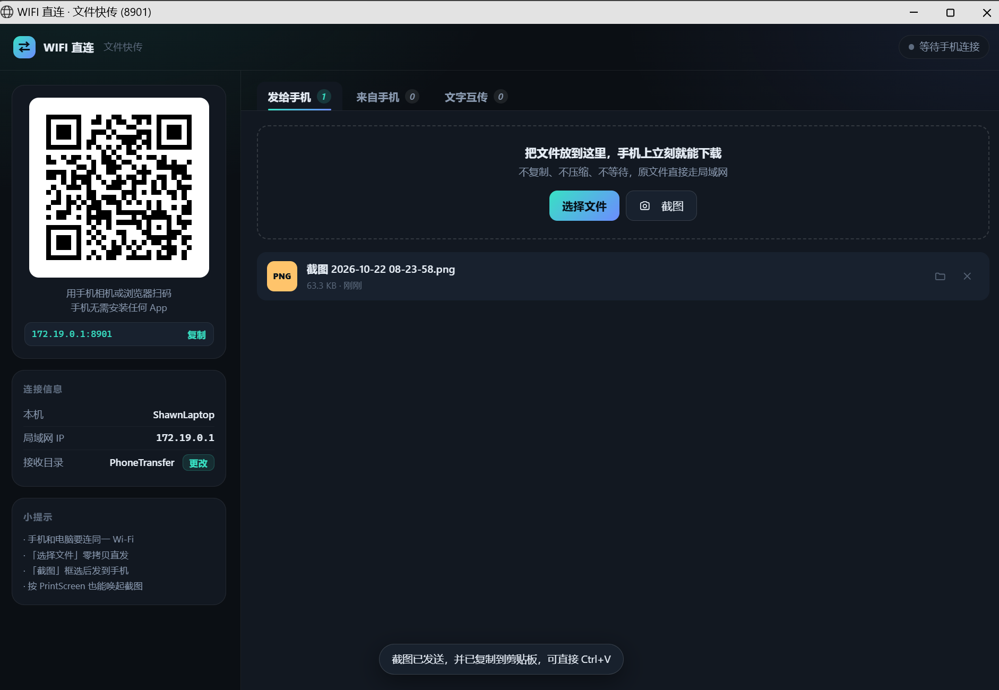
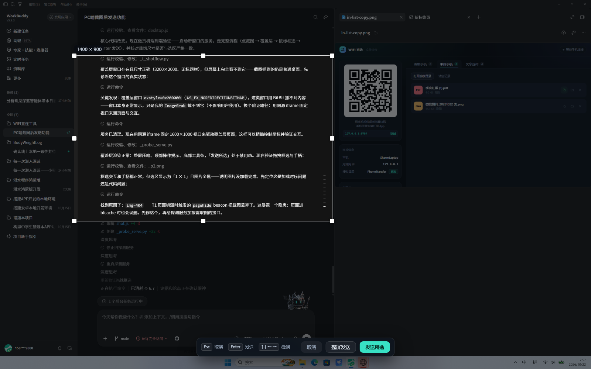
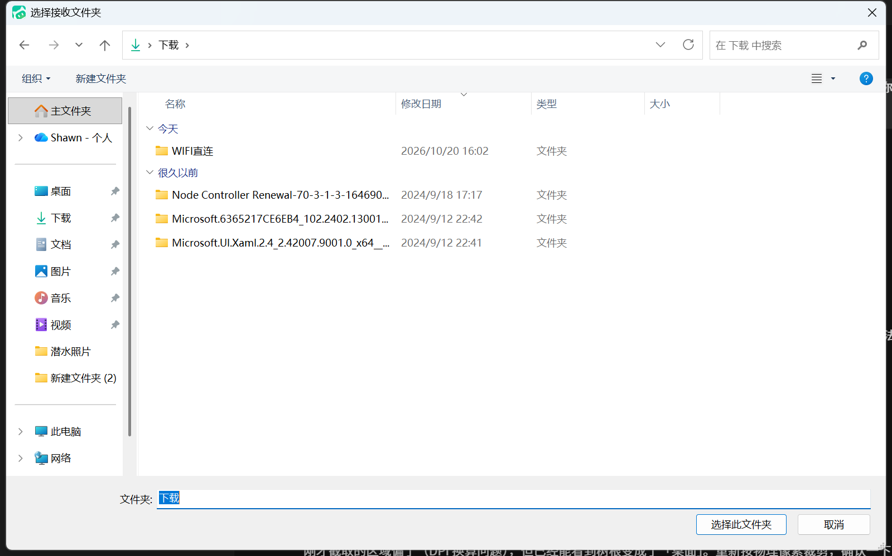
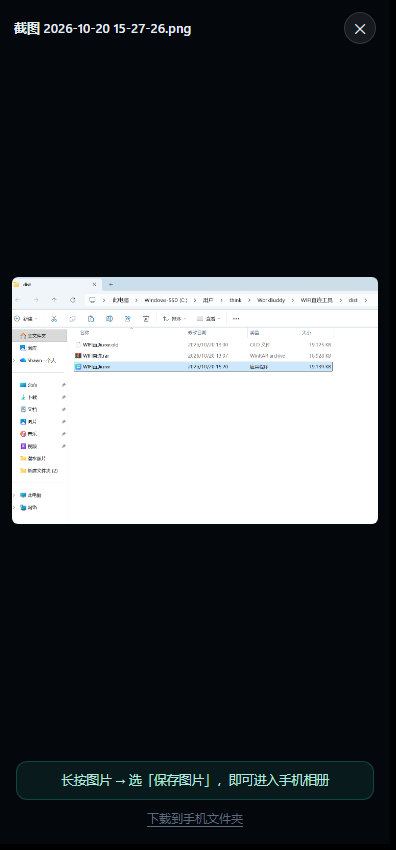

# WIFI 直连 · 文件快传

Windows 电脑 ⇄ 手机，同一个 Wi-Fi 下扫码即传。**手机端不用装任何 App**，鸿蒙、安卓、iOS 都能用。





## 快速开始

1. 双击 `WIFI直连.exe`
2. 电脑上弹出窗口，左边是二维码
3. 手机用**相机**或**浏览器扫一扫**，打开网页
4. 开始传文件

第一次运行时 Windows 可能弹防火墙提示，勾选「专用网络」并点「允许访问」，否则手机连不上。

## 怎么传

| 方向 | 操作 |
| --- | --- |
| 手机 → 电脑 | 手机上点「选择文件」或「拍照上传」，文件存到 `下载\WIFI直连\` |
| 电脑 → 手机 | 电脑上点「选择文件」把文件挂上去，手机上点文件名下载 |
| 电脑图片 → 手机相册 | 手机列表里图片点一下放大，**长按图片 → 选「保存图片」**，直接进相册 |
| 电脑截图 → 手机 | 电脑上点「截图」，拖动框选，回车发出去；按 `PrintScreen` 直接唤起。发出去的同时这张图也**进了 Windows 剪贴板**，可以立刻在任何软件里 Ctrl+V |
| 文字互传 | 手机发的文字自动进电脑剪贴板，直接 Ctrl+V |
| 手机文件 → 其他软件 | 在「来自手机」里点该行的**复制**图标，到微信 / Word / 资源管理器里 Ctrl+V |

手机上收到电脑发来的文件是这个样子（图片直接出缩略图，点开可长按保存）：



### 「复制文件」和「在文件夹中显示」

「来自手机」列表里每一行右侧有三个图标，从左到右：

| 图标 | 作用 | 交互 |
| --- | --- | --- |
| 两个方块（复制） | 把这个**文件本身**放进 Windows 剪贴板，等价于资源管理器里 Ctrl+C | 点一下 → 图标变绿勾约 1 秒 + 底部提示「已复制」，再去目标软件 Ctrl+V 就是粘贴这个文件（不是路径文本） |
| 文件夹 | 在资源管理器里打开接收目录并选中该文件 | 点一下直接弹窗，不留痕迹 |
| × | 删除该文件并把记录从列表移除 | 立即生效 |

两者互补：想**接着用这个文件**（贴进微信对话、插进 Word、拷到 U 盘）用「复制」；想**看看它、重命名、换个位置存**用「文件夹」。
「复制文件」只出现在「来自手机」那边——发给手机的文件本来就在本机，去文件夹里复制更顺手。



复制失败时不会静默：剪贴板被其他程序占着（输入法、剪贴板管理器）、文件已被移走、
没有读取权限，都会在底部弹出具体原因。

### 截图发送

点「截图」（或直接按 `PrintScreen`）：

1. 主窗口自动最小化，屏幕**整屏原样铺开**（真实分辨率、无标题栏），
   看到的就是整个桌面，跟在屏幕上直接比划一样
2. 拖动鼠标框选；松手后四角四边共 8 个手柄都能拖，选区内部还能整体拖动，
   方向键微调 1px（按住 `Shift` 是 10px）
3. 标签上显示的是**真实像素尺寸**，不是缩放后的视觉尺寸
4. `Enter` 或双击发送所选，`Esc` / 右键取消；也可以点「整屏发送」不裁切

发出去的截图会存一份到 `下载\WIFI直连\截图 年-月-日 时-分-秒.png`，同时出现在「发给手机」列表里。
裁切直接在原图上做，落盘分辨率与你框住的那块屏幕区域**逐像素一致**，不会因为显示缩放而变糊。

#### 截完就能直接粘贴

发送成功的**同一步**里，这张图（恰好是你框选的那一块，不是整屏）会以位图的形式放进
Windows 剪贴板。所以截完不用再去文件夹找文件，直接在微信、钉钉、Word、画图、浏览器里
`Ctrl+V`，粘出来的就是这张图本身。

- 落盘 → 写剪贴板 → 才回响应，界面上的「已发送」出现时，两件事都已经完成；
  不会出现「提示发完了、粘贴却是空的」这种时间差。
- 写进剪贴板的是 `CF_DIB`，不是文件：贴到聊天窗口是一张可以直接发送的图，
  而不是一个待发送的文件附件。想贴文件的话，用列表里那一行的「复制」图标。
- 每步（本机保存、加入列表、写剪贴板）成功与否是分开报的。**剪贴板写失败不会撤销截图**：
  图照样存在磁盘上、照样出现在列表里、手机照样能下载，只是少了「随手一贴」这一步，
  主窗口会用红字说明原因。



复制失败的可能原因，都是说清楚原因的：

| 情况 | 提示 |
| --- | --- |
| 剪贴板被输入法 / 剪贴板管理器占着 | 「剪贴板正被其他程序占用，稍等一秒再试」（内部已经重试过约 0.4 秒） |
| 截图文件被别的程序独占或已删 | 「截图文件已被移动或删除」 |
| 内存不够（超大整屏图） | 「申请内存失败，图片太大或内存不足」 |

这类情况重截一次通常就好；也可以到「发给手机」里点那一行的**复制**图标（按文件复制），
或者点文件夹图标直接打开所在目录。

框选期间主窗口一直是最小化的，发送或取消后自动回到前台；即使直接 `Alt+F4` 关掉框选窗，主窗口也会回来。



「选择文件」是**零拷贝**：只是把文件路径挂给手机，不复制、不压缩。几 GB 的电影点一下就能在手机上开始下载，电脑上不占额外空间。拖拽进窗口的文件会存一份临时副本（浏览器安全限制导致拿不到真实路径）。

### 改接收目录

手机传上来的文件默认存到 `下载\WIFI直连\`。想换地方：点侧栏「接收目录」右边那个**更改**，选个文件夹即可，**立即生效**，不用重启；
再点一次选回默认或直接改配置文件都行。选择框是资源管理器那套（面包屑、地址栏、新建文件夹都有），
任何盘、任何层级都点得到，不受当前目录限制。

目录不存在会自动建；路径填错（相对路径、非法字符、只读盘、指向一个文件）会明确报错并且**保持原目录不动**，不会静默失败。



## 接收目录配置

配置文件在 `%APPDATA%\WIFI直连\config.json`（不放 exe 旁边：便携程序可能被丢进 Program Files，那里写不了文件）。

```json
{
  "download_dir": "D:\\手机发来的文件",
  "version": 1
}
```

- **生效时机**：程序启动时读一次；运行时点「更改」改的是内存里那一份 + 同时写回配置文件，立刻生效。
  手工编辑 `config.json` 需要重启程序才生效。
- **优先级**：命令行 `--download-dir` > 配置文件 > 默认 `%USERPROFILE%\Downloads\WIFI直连`。
- **不可用时**：启动时配置指向的目录建不出来/不可写，会退回默认目录并在窗口里显示红色提示（原因写得很具体）；
  运行时改错了则直接拒绝，原目录保持不变。
- 想恢复默认：把 `download_dir` 删掉，或者在界面上重新选回 `下载\WIFI直连`。

## 常见问题

**图片下载到手机后，相册里找不到 / 不让放入相册？**

这是鸿蒙（HarmonyOS 5 起）的系统限制，不是文件坏了：手机只把「图库目录」（`DCIM`、`Pictures`）里的文件收进相册，
浏览器下载的图落在 `Download/`，图库不扫描，文件管理里点「放入相册」也会被判为来路不明而拒绝。

所以图片在手机端**不走下载**，而是点一下直接在浏览器里打开原图，长按图片选「保存图片」——
这条路径是浏览器自己的媒体入库通道，会正确写进 `Pictures/`，立刻出现在相册里。



真想存到下载文件夹（比如发给微信），预览页底部有「下载到手机文件夹」。非图片文件（APK、压缩包、文档）仍然是正常下载。

**手机打不开页面？**
- 确认手机和电脑连的是同一个 Wi-Fi（电脑插网线、手机连 Wi-Fi 通常也算同一个局域网）
- 关掉手机上的 VPN / 代理
- 看一眼窗口里「局域网 IP」后面的网卡名：应该是 `WLAN` 或 `以太网`，**如果是 VPN / `vEthernet` / `VMware`，那这个地址手机一定连不上**
- 点「局域网 IP」可以切到别的网卡的地址，二维码会跟着重画
- 检查 Windows 防火墙是否放行了本程序（专用网络 / 公用网络）

**IP 是怎么选出来的？**

电脑上往往不止一个地址：开了 VPN 会有隧道网卡（如 `172.19.0.1`），装过 VMware / WSL / Docker 会有 `192.168.x.1` 的虚拟网卡。程序不会简单取「默认路由出口」——那样在开 VPN 时必然选错。

它通过 Windows 的 `GetAdaptersAddresses` 读每块网卡的真实属性（介质类型、是否启用、网关、友好名），再打分筛选：

- VPN / 虚拟机 / WSL / 蓝牙这类虚拟网卡重罚，只在没有别的候选时才用
- 有默认网关的加分（真局域网才配网关）
- Wi-Fi、有线以太网优先，`192.168.x` 优于 `10.x`，`172.16–31.x` 视为可疑段
- `169.254.x`（没拿到 DHCP 的自分配地址）直接排除

选中的地址后面会标出网卡名（如 `192.168.43.4 · WLAN`），一眼能判断对不对。

**速度能有多快？**
取决于 Wi-Fi。5GHz Wi-Fi 5 实测 40–80 MB/s，Wi-Fi 6 可以更高，是微信/QQ 的几十倍。

**手机锁屏后传输会中断吗？**
大文件传输时建议别锁屏，浏览器在后台可能被系统挂起。

**安全吗？**
每次启动都会生成一个随机令牌，链接里没有令牌就打不开任何接口。传输只发生在局域网内，不上云、不经服务器。关掉程序，链接立即失效。

**为什么不做鸿蒙原生 App？**
纯血鸿蒙（HarmonyOS NEXT）装不了 Android 的 APK，原生应用要用 ArkTS 打成 `.hap`，还得有华为账号做真机调试签名。对「传文件」这个需求来说，浏览器方案零安装、跨所有手机系统，性价比高得多。如果后续确实需要后台常驻接收、桌面图标，可以再加一层 ArkTS 外壳调用同一套 HTTP 接口。

## 开发

```bash
python -m venv .venv
.venv\Scripts\pip install -r requirements.txt
.venv\Scripts\python run.py
```

常用参数：

```bash
python run.py --headless          # 只起服务，不开窗口
python run.py --port 9000         # 指定端口
python run.py --ip 192.168.1.5    # 指定网卡地址
python run.py --download-dir "D:\手机发来的文件"   # 改接收目录（会写进配置）
```

## 打包

双击 `build.bat`，产物在 `dist\WIFI直连.exe`（单文件，免安装，约 19 MB）。

## 结构

```
run.py                启动入口（选端口、选网卡、读配置、起服务、开窗口）
wifilink/config.py    用户配置：接收目录的读取、校验、落盘
wifilink/netutil.py   网卡枚举与排序（GetAdaptersAddresses），筛掉 VPN / 虚拟机地址
wifilink/store.py     文件/文字清单与会话状态
wifilink/server.py    HTTP 接口：上传、下载、鉴权、二维码
wifilink/desktop.py   应用窗口（Edge --app 模式）
wifilink/picker.py    Windows 原生文件选择框（comdlg32 / IFileOpenDialog）
wifilink/clipboard.py 剪贴板：文件写 CF_HDROP（等价资源管理器 Ctrl+C）、图片写 CF_DIB
wifilink/screen.py    抓屏、临时隐藏自身窗口、按选区裁切
web/desktop.html      电脑端控制台
web/mobile.html       手机端页面
web/static/           样式与脚本
tools/make_icon.py    生成图标
```

界面跑在 Microsoft Edge 的应用窗口模式下（无地址栏、无标签页、独立进程，关闭窗口即退出）。Windows 10/11 都自带 Edge，不需要额外安装运行时。

> 早期版本试过 pywebview，但它的 .NET WebView2 绑定与较新的 WebView2 Runtime 存在 COM 接口不兼容（`E_NOINTERFACE`），部分机器上根本创建不出窗口，因此改为直接驱动 Edge。

## 接口速览

| 方法 | 路径 | 说明 |
| --- | --- | --- |
| GET | `/j/<token>` | 扫码入口，写 cookie 后跳手机端页面 |
| GET | `/api/state` | 状态快照（文件、文字、上传进度，以及最近一次截图的结果 `shot`） |
| GET | `/api/session` | 连接信息：推荐 IP、`ipName`（网卡名）、`ips` / `nics`（全部候选与网关） |
| GET | `/api/ip` | 重新枚举网卡地址（仅本机） |
| PUT | `/api/upload?name=` | 流式上传，body 直接是文件 |
| GET | `/api/download/<id>` | 下载，支持 Range 断点续传 |
| GET | `/api/config` | 读接收目录配置（仅本机） |
| POST | `/api/config` | 改接收目录 `{"downloadDir": "..."}`，`null` 为恢复默认；校验失败返回 400（仅本机） |
| POST | `/api/pc/pickdir` | 弹原生文件夹选择框，只返回路径不生效（仅本机） |
| GET | `/api/img/<id>` | 图片**内联**渲染（正确 `Content-Type`，按文件头嗅探），供手机长按保存 |
| GET | `/api/thumb/<id>?w=` | 列表缩略图（JPEG，内存缓存） |
| POST | `/api/text` | 文字互传 |
| POST | `/api/pc/add` | 桌面端零拷贝登记本地文件（仅本机） |
| POST | `/api/pc/copyfile/<id>` | 把文件以 `CF_HDROP` 放进剪贴板（仅本机；文件丢失 404、剪贴板被占用 503） |
| POST | `/api/pc/screenshot` | 抓整屏并打开全屏框选覆盖层，返回 `{id, w, h}`（仅本机） |
| GET | `/shot?sid=&port=` | 框选覆盖层页面（仅本机） |
| GET | `/api/pc/screenshot/<id>` | 取暂存的整屏原图（仅本机） |
| POST | `/api/pc/screenshot/<id>/send` | 按 `{x,y,w,h}` 在原图上裁切落盘并加入列表，`{full:true}` 为整屏；同时把裁好的图写进剪贴板，返回 `clip: {ok, error}`（仅本机） |
| DELETE | `/api/pc/screenshot/<id>` | 放弃本次截图（删掉暂存图），恢复主窗口（仅本机） |
| POST | `/api/pc/screenshot/<id>/close` | 覆盖层被直接关闭时的兜底：丢弃暂存 + 恢复主窗口（仅本机） |
| GET | `/api/qr.png?ip=` | 二维码 |
